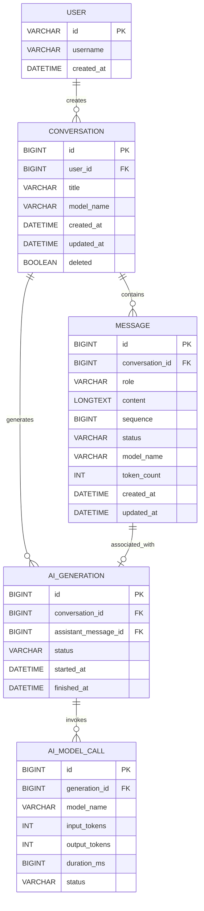

# 个人 AI 助手系统数据库设计文档

**文档版本：** V1.0  
**数据库：** MySQL  
**项目阶段：** 第一阶段基础 AI 会话系统

---

## 1. 数据库设计概述

### 1.1 设计目标

个人 AI 助手系统需要保存用户信息、会话记录、聊天消息以及 AI 模型生成过程中的相关数据。数据库设计主要满足以下需求：

1. 支持用户创建、查询和管理多个会话。
2. 完整保存用户发送的消息和 AI 生成的回复。
3. 支持按照会话查询历史消息，并保证消息顺序正确。
4. 支持 AI 流式生成过程中的状态管理。
5. 记录 AI 生成任务的执行状态，便于处理生成失败、主动取消等情况。
6. 为后续长期记忆、Agent 任务管理和 RAG 功能预留扩展空间。

### 1.2 数据库选型

第一阶段采用 MySQL 作为主要关系型数据库。

选择 MySQL 的原因：

- 能够满足用户、会话和消息等结构化数据的持久化需求。
- 支持事务、索引、外键等机制，便于保证数据一致性。
- 与 Spring Boot、Spring Data JPA 集成成熟。
- 能够支持后续多用户和业务功能扩展。

第一阶段暂时不引入 Redis 和向量数据库，避免增加系统部署和维护成本。

### 1.3 数据存储总体方案

系统按照数据用途划分为以下几类：

| 数据类型 | 存储位置 | 说明 |
|---|---|---|
| 用户信息 | MySQL | 用户基本资料 |
| 会话信息 | MySQL | 会话标题、模型配置等 |
| 聊天消息 | MySQL | 用户消息和 AI 回复 |
| AI 生成任务 | MySQL | 生成状态、执行时间、错误信息 |
| 模型调用记录 | MySQL（可选） | Token 消耗、耗时、模型信息 |
| 短期记忆 | 暂不独立存储 | 从历史消息中动态构建 |
| 长期记忆 | 后续扩展 | 保存用户级或会话级记忆 |
| 临时运行状态 | 后续可使用 Redis | 缓存、任务状态和临时数据 |

第一阶段以 MySQL 作为唯一主要数据来源，避免同一份聊天记录在多个存储系统中重复维护。

---

## 2. 数据库整体结构

### 2.1 核心数据表

第一阶段规划四张核心数据表：

| 表名 | 功能 | 是否必要 |
|---|---|---|
| user | 用户信息 | 必要 |
| conversation | 会话信息 | 必要 |
| message | 聊天消息 | 必要 |
| ai_generation | AI 生成任务 | 推荐 |

另外，可以增加一张 `ai_model_call` 表，用于记录模型调用过程中的 Token 消耗、执行耗时和调用状态。第一阶段可以根据实际需求决定是否实现。

### 2.2 实体关系

核心实体之间的关系如下：

- 一个用户可以创建多个会话。
- 一个会话包含多条聊天消息。
- 一个会话可以产生多个 AI 生成任务。
- 一个 AI 生成任务对应一条 AI 助手回复。
- 一个 AI 生成任务未来可以包含多次模型调用。

整体关系：

```text
User
  |
  | 1:N
  |
Conversation
  |
  | 1:N
  |
Message

Conversation
  |
  | 1:N
  |
AIGeneration
  |
  | 1:N（预留）
  |
AIModelCall
```

其中，`Message` 和 `AIGeneration` 通过 `assistant_message_id` 建立关联。

### 2.3 ER 关系示意



---

## 3. 核心数据表设计

### 3.1 用户表（user）

用户表用于保存系统用户的基本信息，为后续多用户平台提供基础。

| 字段名 | 数据类型 | 约束 | 说明 |
|---|---|---|---|
| id | VARCHAR(16) | PK | 用户 ID |
| username | VARCHAR(64) | NOT NULL, UNIQUE | 用户名 |
| password_hash | VARCHAR(255) | | 注册时保存 BCrypt 密码哈希；兼容已有无密码用户 |
| created_at | DATETIME | NOT NULL | 创建时间 |
| updated_at | DATETIME | NOT NULL | 更新时间 |

设计说明：

1. 用户主键使用 VARCHAR(16)，注册时由服务端生成 16 位随机字符串；会话表 user_id 使用相同类型。
2. 用户名建立唯一索引，避免重复注册。
3. 密码只保存哈希结果，不保存明文。
4. 第一阶段如果暂时只有个人使用，也建议保留用户表和 `user_id` 关联，避免后续多用户扩展时大规模修改数据结构。

### 3.2 会话表（conversation）

会话表用于保存每一次独立的聊天会话。

| 字段名 | 数据类型 | 约束 | 说明 |
|---|---|---|---|
| id | BIGINT | PK | 会话 ID |
| user_id | VARCHAR(16) | FK, NOT NULL | 所属用户 |
| title | VARCHAR(255) | | 会话标题 |
| model_name | VARCHAR(100) | | 使用的模型名称 |
| created_at | DATETIME | NOT NULL | 创建时间 |
| updated_at | DATETIME | NOT NULL | 最近更新时间 |
| deleted | BOOLEAN | NOT NULL, DEFAULT FALSE | 是否删除 |

设计说明：

1. 每个会话必须属于一个用户。
2. `title` 可以在创建会话时使用默认名称，后续根据第一条用户消息生成。
3. `model_name` 用于记录会话当前使用的模型。
4. `updated_at` 在新增消息或修改会话信息时更新。
5. `deleted` 用于软删除，避免误操作直接丢失会话。

建议索引：

- 主键索引：`id`
- 普通索引：`user_id`
- 组合索引：`(user_id, deleted, updated_at)`

组合索引主要用于查询某个用户的会话列表，并按照最近更新时间排序。

### 3.3 消息表（message）

消息表是系统最核心的数据表，用于保存完整的聊天记录。

无论是用户发送的内容，还是 AI 生成的回复，都统一保存在该表中。

| 字段名 | 数据类型 | 约束 | 说明 |
|---|---|---|---|
| id | BIGINT | PK | 消息 ID |
| conversation_id | BIGINT | FK, NOT NULL | 所属会话 |
| role | VARCHAR(20) | NOT NULL | 消息角色 |
| content | LONGTEXT | NOT NULL | 消息内容 |
| sequence | BIGINT | NOT NULL | 会话内消息顺序 |
| status | VARCHAR(20) | NOT NULL | 消息状态 |
| model_name | VARCHAR(100) | | 使用的模型 |
| token_count | INT | | Token 数量 |
| created_at | DATETIME | NOT NULL | 创建时间 |
| updated_at | DATETIME | NOT NULL | 更新时间 |

#### role 字段设计

用于区分不同来源的消息：

| 值 | 含义 |
|---|---|
| user | 用户发送的消息 |
| assistant | AI 助手生成的消息 |
| system | 系统提示词 |
| tool | 工具调用或工具返回的消息 |

第一阶段主要使用 `user` 和 `assistant`，但建议预留 `system` 和 `tool`，以便后续实现 Agent 和工具调用。

#### status 字段设计

| 状态 | 含义 |
|---|---|
| PENDING | 等待生成 |
| STREAMING | 正在流式生成 |
| COMPLETED | 生成完成 |
| FAILED | 生成失败 |
| CANCELLED | 用户主动取消 |

用户消息通常在保存时直接设置为 `COMPLETED`。

AI 回复则随着生成过程改变状态。

#### sequence 字段设计

`sequence` 用于表示消息在同一个会话中的先后顺序。

例如：

| sequence | role | content |
|---|---|---|
| 1 | user | 你好 |
| 2 | assistant | 你好，有什么可以帮你？ |
| 3 | user | 介绍一下 Spring AI |
| 4 | assistant | Spring AI 是一个…… |

建议建立唯一索引：

`UNIQUE(conversation_id, sequence)`

这样可以保证同一个会话内不会出现重复的消息序号。

查询历史消息时按照 `sequence ASC` 排序即可，不依赖时间戳来推断严格顺序。

#### content 字段设计

第一阶段使用 LONGTEXT 保存普通文本内容。

未来支持图片、文件、音频等多模态消息时，可以进一步调整为结构化 JSON，或者增加附件关联表，而不必在第一阶段提前引入复杂的数据结构。

#### 建议索引

- 主键索引：`id`
- 组合唯一索引：`(conversation_id, sequence)`
- 普通索引：`(conversation_id, created_at)`

历史消息分页查询优先使用 `conversation_id + sequence` 组合索引。

### 3.4 AI 生成任务表（ai_generation）

该表用于管理一次 AI 回复的生成过程。

它与消息表的职责不同：

- `message` 负责保存消息内容及消息本身的状态。
- `ai_generation` 负责记录一次生成任务的执行过程。

| 字段名 | 数据类型 | 约束 | 说明 |
|---|---|---|---|
| id | BIGINT | PK | 生成任务 ID |
| conversation_id | BIGINT | FK, NOT NULL | 所属会话 |
| assistant_message_id | BIGINT | FK, NOT NULL, UNIQUE | 对应的 AI 回复消息 |
| status | VARCHAR(20) | NOT NULL | 任务状态 |
| started_at | DATETIME | | 开始时间 |
| finished_at | DATETIME | | 结束时间 |
| error_message | TEXT | | 错误信息 |
| created_at | DATETIME | NOT NULL | 创建时间 |

#### status 字段设计

| 状态 | 含义 |
|---|---|
| PENDING | 等待执行 |
| RUNNING | 正在执行 |
| COMPLETED | 执行成功 |
| FAILED | 执行失败 |
| CANCELLED | 已取消 |

状态变化：

```text
PENDING
   |
   v
RUNNING
   |
   +------> COMPLETED
   |
   +------> FAILED
   |
   +------> CANCELLED
```

设计说明：

1. 一个生成任务对应一条 AI 回复消息。
2. `assistant_message_id` 使用唯一约束，避免一条回复消息关联多个生成任务。
3. `error_message` 用于保存模型调用失败、网络异常等信息。
4. `started_at` 和 `finished_at` 可以用于统计模型响应时间。

引入该表主要是为了支持 SSE 流式生成、主动停止生成以及后续 Agent 长时间任务管理。

### 3.5 模型调用记录表（ai_model_call，可选）

该表用于记录 AI 生成过程中实际发生的模型调用。

第一阶段可以暂不实现，但建议在数据库设计中预留。

| 字段名 | 数据类型 | 约束 | 说明 |
|---|---|---|---|
| id | BIGINT | PK | 调用记录 ID |
| generation_id | BIGINT | FK, NOT NULL | 所属生成任务 |
| model_name | VARCHAR(100) | NOT NULL | 模型名称 |
| provider | VARCHAR(100) | | 模型提供商 |
| input_tokens | INT | | 输入 Token 数 |
| output_tokens | INT | | 输出 Token 数 |
| duration_ms | BIGINT | | 调用耗时 |
| status | VARCHAR(20) | NOT NULL | 调用状态 |
| error_message | TEXT | | 错误信息 |
| created_at | DATETIME | NOT NULL | 调用时间 |

设计说明：

1. 一次普通 AI 回复通常只涉及一次模型调用。
2. 后续 Agent 可能在一次任务中多次调用模型，因此需要独立记录。
3. 可以通过该表统计 Token 消耗、模型调用次数和执行耗时。
4. 不建议把模型调用的全部输入输出内容重复保存到该表中，避免与消息表产生大量冗余。

---

## 4. 数据一致性与索引设计

### 4.1 外键关系

建议建立以下外键：

| 子表 | 外键字段 | 关联表 | 关联字段 |
|---|---|---|---|
| conversation | user_id | user | id |
| message | conversation_id | conversation | id |
| ai_generation | conversation_id | conversation | id |
| ai_generation | assistant_message_id | message | id |
| ai_model_call | generation_id | ai_generation | id |

其中 `ai_model_call` 属于可选表。

### 4.2 索引汇总

| 数据表 | 索引 | 用途 |
|---|---|---|
| user | UNIQUE(username) | 用户名唯一性 |
| conversation | (user_id, deleted, updated_at) | 查询用户会话列表 |
| message | UNIQUE(conversation_id, sequence) | 保证消息顺序唯一 |
| message | (conversation_id, created_at) | 辅助消息时间查询 |
| ai_generation | UNIQUE(assistant_message_id) | 保证回复关联唯一 |
| ai_generation | (conversation_id, status) | 查询会话生成任务 |
| ai_model_call | (generation_id) | 查询任务调用记录 |

索引应根据实际 SQL 查询情况调整，避免建立过多索引影响写入性能。

### 4.3 事务处理

用户发送消息和 AI 生成任务创建时，需要注意数据库事务边界。

建议：

1. 保存用户消息。
2. 创建一条 AI 回复消息，初始状态为 `PENDING`。
3. 创建对应的 AI 生成任务，初始状态为 `PENDING`。
4. 提交数据库事务。
5. 在事务外执行模型调用和 SSE 流式输出。
6. 生成结束后更新 AI 回复消息和生成任务的状态。

不要在整个模型生成期间一直占用数据库事务，否则长时间的网络调用可能导致数据库连接和事务资源被持续占用。

---

## 5. 对话历史与短期记忆设计

### 5.1 对话历史和短期记忆的区别

两者虽然都与聊天消息有关，但用途不同。

**对话历史（Chat History）**

保存用户与 AI 的完整交互记录，是需要长期持久化的数据。

**短期记忆（Short-term Memory）**

用于构建当前模型请求的上下文，决定本次请求需要向模型提供哪些历史信息。

短期记忆不一定需要单独建立数据库表。

### 5.2 第一阶段实现方案

第一阶段直接从 `message` 表读取历史消息，再由 AI Service 内部的 Context Manager 进行处理。

基本流程：

```text
用户发送新消息
      |
      v
查询当前会话历史消息
      |
      v
Context Manager
      |
      v
筛选最近 N 条消息
      |
      v
检查 Token 预算
      |
      v
构建模型上下文
      |
      v
调用 AI 模型
```

上下文管理可以作为 AI Service 内部的一个组件，不需要单独部署服务。

### 5.3 后续记忆系统扩展

当系统需要跨会话记忆用户偏好、个人习惯和重要信息时，可以增加 `user_memory` 表。

建议字段：

| 字段名 | 数据类型 | 说明 |
|---|---|---|
| id | BIGINT | 主键 |
| user_id | BIGINT | 所属用户 |
| memory_type | VARCHAR(50) | 记忆类型 |
| content | TEXT | 记忆内容 |
| source_conversation_id | BIGINT | 来源会话 |
| created_at | DATETIME | 创建时间 |
| updated_at | DATETIME | 更新时间 |

未来还可以进一步区分：

- Conversation Memory：会话级记忆。
- User Memory：用户级长期记忆。
- Working Memory：Agent 执行任务时的临时状态。

如果后续需要语义检索，再引入向量数据库或支持向量检索的存储方案。

---

## 6. SSE 流式输出与数据持久化

由于系统使用 SSE 实现 AI 回复的流式输出，因此需要考虑生成过程中的消息保存策略。

### 6.1 推荐处理流程

```text
用户发送消息
      |
      v
保存 User Message
      |
      v
创建 Assistant Message
status = PENDING
      |
      v
创建 AI Generation
status = PENDING
      |
      v
开始调用模型
      |
      v
更新状态为 STREAMING / RUNNING
      |
      v
模型持续返回 Token
      |
      +------> SSE 推送前端
      |
      +------> 服务端缓冲生成内容
      |
      v
生成完成
      |
      v
保存完整 AI 回复
      |
      v
更新 Message 和 Generation 状态
      |
      v
COMPLETED
```

### 6.2 持久化策略

不建议每收到一个 Token 就执行一次数据库 UPDATE。

这样会造成大量无意义的数据库写入，影响系统性能。

推荐采用以下方式：

1. 创建 AI 回复时先保存一条空内容或初始内容的消息记录。
2. 生成过程中在服务端使用缓冲区暂存内容。
3. SSE 持续向前端推送生成结果。
4. 正常完成后，将完整内容一次性写入 MySQL。
5. 如果生成失败或被取消，尽可能保留已经生成的部分内容，并更新消息和任务状态。

第一阶段不需要实现定时检查点。未来如果需要支持超长任务、服务重启恢复或 Agent 执行过程恢复，再增加 checkpoint 机制。

### 6.3 状态一致性

`message.status` 和 `ai_generation.status` 需要保持合理的一致性。

| 场景 | Message 状态 | Generation 状态 |
|---|---|---|
| 等待生成 | PENDING | PENDING |
| 正在生成 | STREAMING | RUNNING |
| 正常完成 | COMPLETED | COMPLETED |
| 生成失败 | FAILED | FAILED |
| 用户取消 | CANCELLED | CANCELLED |

如果系统异常导致两张表状态不一致，需要在后续实现中增加异常处理或状态修复逻辑。

---

## 7. 数据生命周期与删除策略

### 7.1 会话删除

用户删除会话时，第一阶段建议使用软删除。

将 `conversation.deleted` 设置为 `TRUE`，普通会话列表查询时过滤已删除记录。

软删除的好处：

- 避免误删导致聊天记录无法恢复。
- 为后续回收站功能留出空间。
- 方便进行数据恢复和问题排查。

### 7.2 消息删除

第一阶段不建议提供独立的单条消息删除功能。

消息生命周期跟随会话管理，避免删除部分消息后造成上下文不完整。

如果未来支持会话永久删除，则应在事务中明确处理关联消息和生成记录。

### 7.3 物理删除

可以在未来增加定期清理任务，对用户确认永久删除的数据执行物理删除。

删除时需要考虑：

1. 先删除模型调用记录。
2. 删除 AI 生成任务。
3. 删除会话消息。
4. 删除会话记录。
5. 最后根据业务要求处理用户数据。

如果使用外键约束，需要明确配置删除规则，避免意外级联删除。

---

## 8. 数据库扩展规划

第一阶段只需要 MySQL 即可满足需求。随着功能扩展，可以逐步增加以下存储能力。

| 阶段 | 存储方案 | 主要用途 |
|---|---|---|
| 第一阶段 | MySQL | 用户、会话、消息、生成任务 |
| 第二阶段 | MySQL + Redis | 缓存、临时状态、限流、任务协调 |
| 第三阶段 | 增加记忆存储 | 用户长期记忆、会话摘要 |
| 第四阶段 | 增加向量数据库 | 语义检索、RAG、长期记忆检索 |
| 后续 | 文件对象存储 | 图片、文档、音频等附件 |

需要注意：Redis 主要承担缓存和临时状态管理职责，不应直接取代 MySQL 成为聊天记录的唯一存储位置。

---

## 9. 第一阶段数据库实施范围

为了控制项目初期的复杂度，第一阶段建议实际实现以下内容：

| 内容 | 实施情况 |
|---|---|
| user 表 | 实现 |
| conversation 表 | 实现 |
| message 表 | 实现 |
| ai_generation 表 | 建议实现 |
| ai_model_call 表 | 暂缓 |
| user_memory 表 | 暂缓 |
| Redis | 暂不引入 |
| 向量数据库 | 暂不引入 |
| 文件附件表 | 暂缓 |

第一阶段重点完成：

1. 用户与会话之间的关联。
2. 会话与消息之间的关联。
3. 消息顺序管理。
4. AI 回复内容持久化。
5. SSE 生成任务状态管理。
6. 历史消息查询和分页。
7. 会话软删除。

---

## 10. 总结

本系统第一阶段采用 MySQL 作为主要数据存储方案，以 `user`、`conversation`、`message` 和 `ai_generation` 四张表构成核心数据模型。

其中，消息表统一保存用户输入和 AI 输出；生成任务表负责管理模型生成过程；短期记忆不单独持久化，而是通过读取历史消息并结合上下文管理组件动态构建。

这种设计能够满足基础 AI 对话、历史记录查询和 SSE 流式输出等核心需求，同时避免过早引入 Redis、向量数据库和复杂记忆系统。

后续随着 Agent、长期记忆和 RAG 功能的加入，再逐步扩展模型调用记录、用户记忆、任务执行记录和向量检索能力，从而保证系统整体架构具有较好的可维护性和扩展性。
